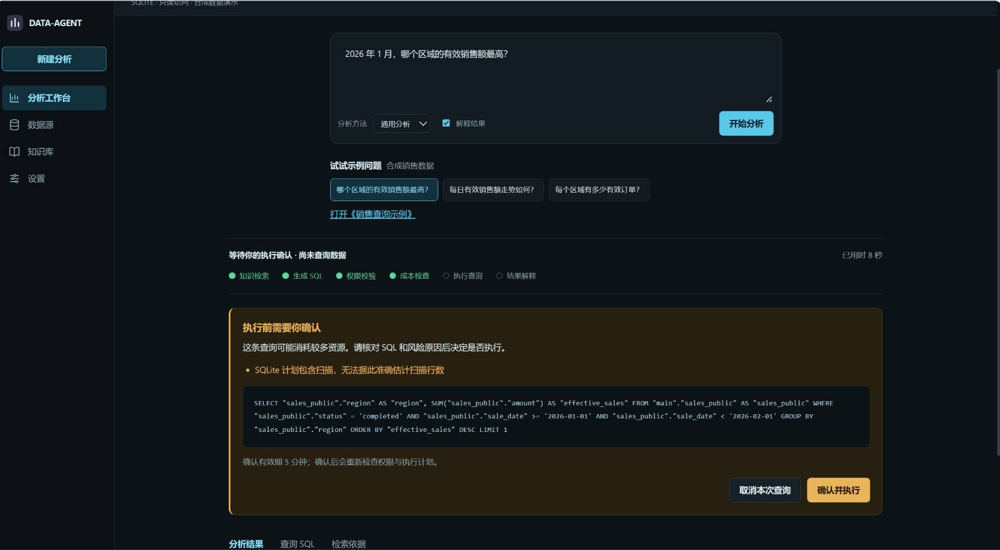

# DATA-AGENT

面向多数据源的安全数据分析 Agent。用户通过自然语言描述问题，系统检索表结构与业务口径，生成 SQL，经权限和成本检查后只读执行，再返回表格、图表和解释。

## 主要功能


| 模块         | 当前实现                                                                                 |
| ------------ | ---------------------------------------------------------------------------------------- |
| 数据接入     | SQLite 演示源；PostgreSQL/MySQL 执行适配；CSV/XLSX 离线导入 DuckDB                       |
| 业务知识检索 | 授权 Schema、指标定义和 PDF/DOCX/Markdown/TXT 文档；Qdrant 向量检索 + BM25 + RRF         |
| 自然语言分析 | 依据问题、检索证据和 Skill 生成 SQL；信息不足时允许返回澄清问题                          |
| SQL 治理     | SQLGlot AST、CTE/子查询作用域、表列白名单、函数限制与结果行数上限                        |
| 受控执行     | 专用连接池、只读执行、超时取消适配、EXPLAIN 与高成本查询二次确认                         |
| 安全结果     | 字段脱敏，页面、模型解释和导出共享同一份安全结果                                         |
| Skill        | 通用、维度对比和趋势三个分析说明文件，由用户选择                                         |
| MCP          | 通过 stdio 对外提供 retrieve_context 和 query_readonly，复用同一安全 API                 |
| 工作台       | 对话、数据源和知识库在同一页面切换，共享当前数据源；支持 SSE、SQL、表格、图表和 CSV 导出 |

侧栏「数据源」复用框架的数据库接入功能。点击「添加数据源」，先从后端提供的数据库类型中选择，再填写该类型的连接信息、测试并保存。已有连接可以编辑、刷新表结构或删除。登记连接不等于开放查询；授权范围和知识文档仍由服务端配置维护。工作台可以查看授权表、指标与文档，并检索当前数据源的知识。

侧栏「设置」可独立配置对话、向量和重排模型。填写 API 前缀或对应的完整接口地址、模型 ID 和 API Key，测试并保存后，下次相应操作生效。对话使用 `/chat/completions`；向量使用 `/embeddings`，在启用向量检索的数据源上使用，与 Qdrant 索引按模型隔离；重排使用 `/rerank`，未配置时保留原检索结果排序。远程模型请求跟随后端所在机器的系统代理或代理环境变量；本机模型直连。密钥加密保存在服务端，不会回显。

侧栏「知识库 → 业务文档 → 添加文档」把 PDF、DOCX、Markdown 或 TXT 添加到当前数据源的检索范围（单文件不超过 10 MB），不会新建数据库表。使用外部向量或重排模型时，授权范围内的文档文本会发送给配置的服务商。管理功能使用启动发放的工作台令牌；多用户环境可配置独立的 `DATA_AGENT_ADMIN_TOKEN`（加入已授权的主体），普通分析令牌不会获得管理权限。

## 实机截图





## 核心流程

```text
页面 / MCP → 认证授权 → 业务知识检索 → Skill + 模型生成 SQL
→ AST 校验 → EXPLAIN / 必要确认 → 只读执行 → 脱敏 → 表格、图表与解释
```

提供 SQL 时跳过检索和生成，但仍执行安全检查。高成本确认不占用数据库连接等待；确认请求重新检查 SQL 与执行计划。

## Windows 本地启动

首次运行需要 Python 3.11 和 `uv`。在项目根目录创建环境并安装本地包：

```powershell
uv venv --python 3.11
uv pip install --python .\.venv\Scripts\python.exe `
  -e ./packages/dbgpt-core -e ./packages/dbgpt-client `
  -e ./packages/dbgpt-ext -e ./packages/dbgpt-sandbox `
  -e ./packages/dbgpt-accelerator/dbgpt-acc-auto `
  -e './packages/dbgpt-serve[safe_analysis_mcp,safe_analysis_files,safe_analysis_databases,safe_analysis_qdrant]' `
  -e ./packages/dbgpt-app
```

默认配置从当前 PowerShell 会话读取模型密钥。用自己的 OpenAI 兼容服务凭据填写这两个环境变量，再启动：

```powershell
$env:LLM_MODEL_API_KEY = '<对话模型密钥>'
$env:EMBEDDING_MODEL_API_KEY = '<向量模型密钥>'
.\start-data-agent.cmd
```

默认模型为 `gpt-4o-mini` 和 `text-embedding-3-small`。使用其他兼容服务时，可在启动前设置 `LLM_MODEL_API_BASE`、`EMBEDDING_MODEL_API_URL`、`LLM_MODEL_NAME` 和 `EMBEDDING_MODEL_NAME`。若在启动配置中更换对话模型名称，请同步更新 `configs/safe-analysis.example.json` 的 `model`，或启动后在工作台「设置」中保存对应模型。

服务启动后打开 http://127.0.0.1:5670/，在左侧进入分析、数据源、知识库或设置。首次启动会生成 10,000 行合成销售数据，选一个预设问题即可试用。使用 `Ctrl+C` 停止服务。

## Docker 启动

镜像包含后端、静态工作台和 Qdrant 本地客户端，使用远端 OpenAI 兼容模型 API，不要求本地 GPU。首次构建仍需下载原框架的完整依赖，镜像并非轻量独立后端。

```powershell
Copy-Item docker/data-agent/.env.example docker/data-agent/.env
```

编辑 docker/data-agent/.env，填写 LLM_MODEL_API_KEY、EMBEDDING_MODEL_API_KEY 和随机的 DATA_AGENT_ENCRYPT_KEY。需要时修改模型名称和 API 地址。DATA_AGENT_TOKEN 至少 32 字符；留空则启动时生成，重启后可能变化，从日志读取。

```powershell
docker compose --env-file docker/data-agent/.env -f docker/data-agent/compose.yaml up --build -d
docker compose --env-file docker/data-agent/.env -f docker/data-agent/compose.yaml logs -f
```

容器默认只向本机发布 5670 端口，供带凭据的 API/MCP 客户端使用；本机免输入的浏览器工作台请用上面的 Windows 一键启动。演示数据、Qdrant 索引、审计和框架状态写入命名卷。

构建两个用途的本地镜像：

```powershell
docker build -f docker/data-agent/Dockerfile --target web -t data-agent:local .
docker build -f docker/data-agent/Dockerfile --target mcp -t data-agent-mcp:local .
```

MCP 镜像使用 stdio，需要正在运行的 Web 服务和相同的工作台令牌：

```powershell
docker run --rm -i --env-file docker/data-agent/.env -e DATA_AGENT_BASE_URL=http://host.docker.internal:5670 data-agent-mcp:local
```

MCP 模式不要加 -t；令牌留空自动生成时，先将 Web 日志中的令牌填入 .env。MCP 工具不提供自动批准高成本查询的能力。

停止服务保留数据：

```powershell
docker compose --env-file docker/data-agent/.env -f docker/data-agent/compose.yaml down
```

本版本提供 Web/MCP Docker 构建目标和 Compose 配置。发布验证覆盖 Compose 配置解析，容器构建及启动尚未验收。

## 目录与阅读顺序


| 位置                                                                 | 职责                                        |
| -------------------------------------------------------------------- | ------------------------------------------- |
| packages/dbgpt-serve/src/dbgpt_serve/safe_analysis/service.py        | 主流程，建议最先阅读                        |
| 同目录 retrieval.py / knowledge.py                                   | 混合检索、文档解析                          |
| 同目录 model.py / skills.py / skills/                                | 模型适配与分析 Skill                        |
| 同目录 guard.py / executor.py / audit.py / results.py                | 校验、执行、确认、审计与结果处理            |
| 同目录 mcp_server.py                                                 | MCP → 安全 HTTP API 适配                   |
| packages/dbgpt-app/src/dbgpt_app/openapi/api_v1/safe_analysis_api.py | HTTP/SSE 接口                               |
| packages/dbgpt-app/src/dbgpt_app/safe_analysis_web/                  | DATA-AGENT 工作台                           |
| docker/data-agent/                                                   | Dockerfile、Compose、启动入口及环境变量模板 |

工作台的 HTML、CSS、JavaScript 和数据库图标由 Python 后端直接提供，Windows 启动无需构建 `web/`。

- [运行与阅读指南](learn/SAFE_ANALYSIS_GUIDE_CN.md)
- [接口文档](learn/SAFE_ANALYSIS_API_CN.md)
- [代码精简审查](learn/SAFE_ANALYSIS_CLEANUP_REVIEW_CN.md)

## 验证与边界

本地通过 79 项安全分析测试，覆盖 SQL 拦截、只读执行、确认流程、HTTP/SSE、数据库图标、文件解析、MCP 与 Qdrant 本地持久化。浏览器预览使用固定测试模型和合成数据。

默认演示库有 10,000 行合成数据。PostgreSQL/MySQL 需真实环境联调，只读账号和数据库安全视图由管理员配置。Qdrant 本地模式用于单 Web 进程。业务文档上传支持带可提取文本的 PDF、DOCX、Markdown 和 TXT。

## 安全与开源归属

不要提交 .env、个人 API key、工作台令牌、上传数据、运行数据库及日志。Docker 构建不复制个人模型配置；Compose 通过运行时环境变量传入密钥。

DATA-AGENT 基于 [DB-GPT](https://github.com/eosphoros-ai/DB-GPT) 开发，保留原框架版权和 [MIT License](LICENSE)。
