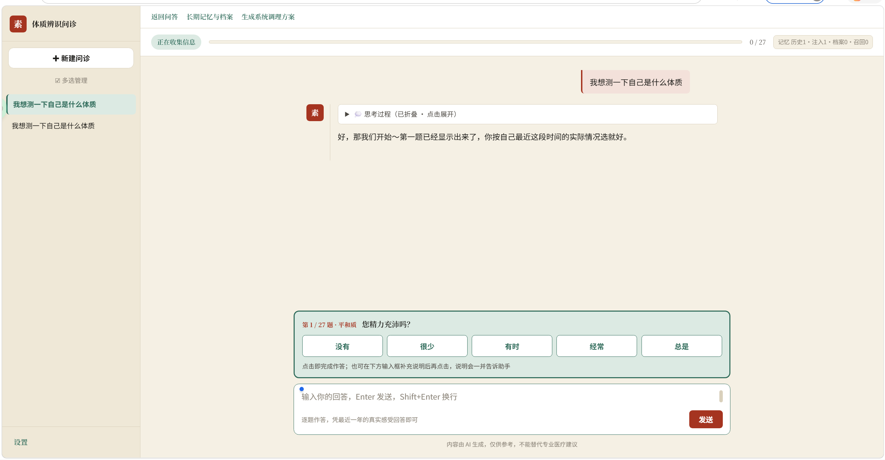
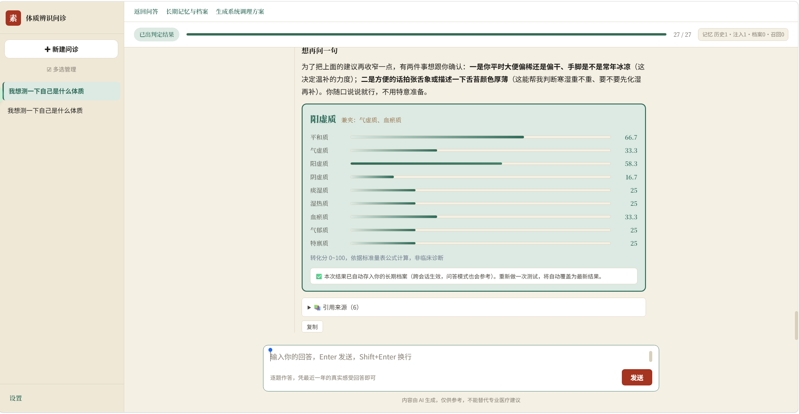

# 中医领域知识检索增强问答系统

中医养生科普助手，基于 [djp0417/tcm-rag-agent](https://github.com/djp0417/tcm-rag-agent) 改造，采用 [MIT 许可证](LICENSE)。

## 实机演示





## 功能与实现边界

- **文档入库**：解析 PDF、Markdown、TXT 和 JSON，按章节、句界和长度预算切分，保存来源位置与片段标识。扫描 PDF 可选用 OCR，长度预算默认按 UTF-8 字节保守估算。
- **混合检索**：Faiss-HNSW 向量召回与 BM25 关键词召回，通过 RRF 融合，经过质量过滤、去重和 API 重排后得到候选证据。
- **动态补查**：模型判断证据覆盖是否充分，返回证据编号、缺口和下一次查询；最多执行三轮检索，并限制重复查询。输出引用经过核查，证据不足时提示限制。
- **分层记忆**：滑动窗口与历史摘要管理短期上下文；向量相似度、医疗词典实体权重与轮次衰减筛选长期记忆，使用大模型辅助判断冲突并隔离。这里使用词典实体识别和模型冲突判断，不包含独立训练的医疗 NER、NLI 模型。
- **多 Agent 协作**：集成上游 LangGraph 流程，完成路由、信息完整性检查，食疗、经络、运动起居角色并行生成候选内容，再汇总、审核、有限次改写。多个角色可以共用同一个模型服务。
- **索引更新一致性**：文档版本与唯一任务标识、SQLite 状态管理、单写入锁和不可变索引快照；构建成功才切换活动快照，失败保留旧版本并支持重试。
- **评估与溯源**：提供检索、记忆选择与 RAGAS 评测入口，记录引用位置和失败样本。仓库仅有格式示例数据，未验证“700 条测试集”及简历中的提升比例。
- **网页设置**：大模型、向量模型、重排模型分别设置 API 地址、模型名称和 Key，支持后台建库进度与失败重试。保存后不回显密钥。
- **MCP 适配代码**：提供检索、安全检查、体质判断、信息缺口工具与只读资源。协议服务需要另装兼容 MCP SDK，目前未完成外部客户端联调。项目未实现运行时 Skill 加载机制。

界面、会话存储、问卷和多角色流程继承上游；本次改造集中于检索与索引链路、记忆策略、引用核查、服务配置及工程整理。

## 核心链路

离线：资料 → 解析/OCR → 分块与来源标记 → 向量化 → 构建 Faiss 快照 → 原子切换活动版本。

在线：用户问题 → 上下文与记忆 → 追问改写及意图/安全检查 → 混合召回 → 过滤与重排 → 判断证据缺口并按需补查 → 生成回答 → 引用核查 → 更新历史和记忆。

网页有三个独立入口：普通 RAG 问答 `/`、工具调用与问卷 `/agent`、多角色方案流程。它们并非每次请求都依次执行。


## Windows 本地启动

安装 Python 3.12 时勾选 **Add Python to PATH**，然后双击根目录的 **`启动中医问答.cmd`**。脚本会自动检查 Python、创建 `.venv` 并安装依赖，再启动网页。首次安装需要联网；后续依赖版本一致时直接启动。出错时窗口会保留错误提示，修正后重新双击即可。

无需先手动创建环境。若希望手动安装，也可以执行：

```powershell
python -m venv .venv
.venv\Scripts\python.exe -m pip install -r requirements.txt
```

启动器在后台启动本机服务并打开浏览器。黑窗自动退出后，服务继续运行。重复双击会复用已有服务。默认首页为 [127.0.0.1:7860](http://127.0.0.1:7860/)，占用时尝试 7861 至 7869。日志位于 `store/server.log`。自动安装入口为 `tools/start.ps1`，OCR 和评测依赖按需另装。

首次进入设置页，分别填写三组服务的地址、模型名称和 Key，点击“保存设置”，再点击“建立 / 更新知识库”。建库成功后返回问答。大模型和向量服务使用 OpenAI 兼容接口，地址通常以 `/v1` 结尾。重排服务可以填完整的 `/rerank` 地址，需要兼容 Cohere 的 `results/index/relevance_score` 格式。遇到 401 时检查密钥，遇到 422 时检查地址和模型名称是否匹配。

发送消息后输入框会立即清空，生成期间按钮变为“停止生成”。点击后保留已显示的内容，并通知后端停止后续步骤。正在等待的外部 API 调用可能需要返回后才能退出；同一会话退出前会阻止重复生成。普通问答、问诊和多角色方案均支持停止。


手动启动或检查解析：

```powershell
# 只解析分块，不调用模型 API
.venv\Scripts\python.exe -X utf8 -m app.index --report-only --no-ocr
# 建库
.venv\Scripts\python.exe -X utf8 -m app.index
# 补偿失败或中断的任务
.venv\Scripts\python.exe -X utf8 -m app.index --retry-only
# 启动 Web 服务
.venv\Scripts\python.exe -X utf8 -m app.server --port 7860
# 命令行问答
.venv\Scripts\python.exe -X utf8 -m app.ask
```

扫描 PDF 需要额外安装 `requirements-ocr.txt`；RAGAS 需要 `requirements-eval.txt`；开发检查需要 `requirements-dev.txt`。

## 资料来源

仓库附带 6 份上游知识卡片，以及《黄帝内经》睡眠与四季起居导读。古籍 TXT 与健康科普 PDF 在本机 `data/` 下使用，由 Git 忽略。复制到新环境后，在设置页建立知识库。


| 本地资料                                        | 来源                                                                                                                       |
| ----------------------------------------------- | -------------------------------------------------------------------------------------------------------------------------- |
| 神农本草经                                      | [古籍原文件](https://github.com/xiaopangxia/TCM-Ancient-Books/blob/master/000-神农本草经.txt)                              |
| 黄帝内经素问                                    | [古籍原文件](https://github.com/xiaopangxia/TCM-Ancient-Books/blob/master/437-黄帝内经素问.txt)                            |
| 黄帝内经灵枢集注                                | [古籍原文件](https://github.com/xiaopangxia/TCM-Ancient-Books/blob/master/431-黄帝内经灵枢集注.txt)                        |
| 八十一难经                                      | [古籍原文件](https://github.com/xiaopangxia/TCM-Ancient-Books/blob/master/421-八十一难经.txt)                              |
| 伤寒论                                          | [古籍原文件](https://github.com/xiaopangxia/TCM-Ancient-Books/blob/master/457-伤寒论.txt)                                  |
| 金匮要略方论                                    | [古籍原文件](https://github.com/xiaopangxia/TCM-Ancient-Books/blob/master/499-金匮要略方论.txt)                            |
| 医学三字经                                      | [古籍原文件](https://github.com/xiaopangxia/TCM-Ancient-Books/blob/master/592-医学三字经.txt)                              |
| 饮膳正要                                        | [古籍原文件](https://github.com/xiaopangxia/TCM-Ancient-Books/blob/master/009-饮膳正要.txt)                                |
| 中国公民健康素养基本知识与技能释义（2024 年版） | [国家卫健委 PDF](https://www.nhc.gov.cn/xcs/c100123/202404/c30d31cb877749ce94ce23d2c55ad973/files/1733220375762_77083.pdf) |

项目读取 UTF-8 文本。GB18030 古籍需先转为 UTF-8，`<篇名>` 可转为 Markdown 章节标题以保留引用位置。本机下载记录和校验值见 `store/verification/public-sources.json`。古籍中的方药和针刺记载用于文献阅读。

## 模块导航


| 路径                                          | 职责                                 |
| --------------------------------------------- | ------------------------------------ |
| `app/knowledge/documents.py`、`ocr.py`        | 多格式解析、OCR、分块和原文位置      |
| `app/knowledge/store.py`、`runtime.py`        | 版本化任务、Faiss 快照与共享实例     |
| `app/knowledge/retrieval.py`、`decision.py`   | 混合召回、重排、证据缺口判断与补查   |
| `app/rag.py`、`knowledge/citations.py`        | 统一问答链路与引用核查               |
| `app/memory.py`、`knowledge/memory_policy.py` | 上下文摘要、记忆筛选与冲突隔离       |
| `app/agent/`、`app/multiagent/`               | 问卷状态机、工具调用、LangGraph 编排 |
| `app/config.py`、`app/web_settings.py`        | 三组模型配置与后台建库接口           |
| `app/server.py`、`web/`                       | FastAPI、SSE 与网页                  |
| `app/mcp/`                                    | 对外工具和只读资源适配               |

前端的问答、问诊和设置分别在 `web/index.html`、`web/agent.html`、`web/settings.html`，对话控制共用 `web/chat-controls.js`。三个页面采用「素问」主题，米色背景、墨色文字、朱砂强调色，样式在各自的 HTML 中。

## 检查与评测

```powershell
.venv\Scripts\python.exe -m pip install -r requirements-dev.txt
.venv\Scripts\python.exe -m pytest -q
.venv\Scripts\python.exe -m ruff check app tools tests
.venv\Scripts\python.exe -X utf8 -m tools.frontend_render_check
# RAGAS 需要额外评测依赖、可用 API 和已建立的知识库
.venv\Scripts\python.exe -m app.knowledge.evaluate --dataset eval/local_example.jsonl --generate --ragas
.venv\Scripts\python.exe -m app.knowledge.evaluate_memory --dataset eval/memory_example.jsonl
```

文献评测需要为每题标注 `gold_sources` 或 `gold_chunk_ids`，RAGAS 还需要 `reference` 参考答案。Faiss 的 P95 单独计时，完整问答耗时另计。同一数据集的报告可用 `--baseline-report` 比较。评测入口与工程测试已经接通，700 条样本及简历中的提升比例仍需真实数据和报告支持。上游的 `eval/testset.jsonl` 可供 `app.eval` 的行为诊断使用。
