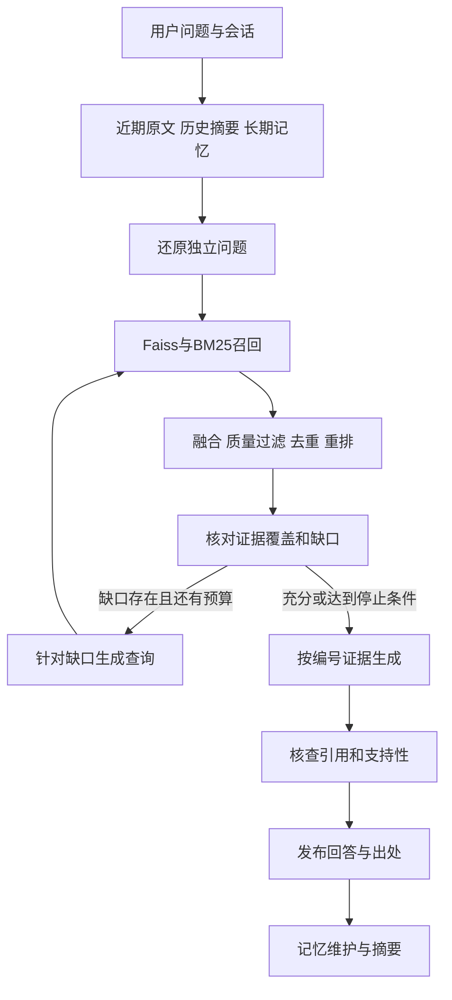

# 中医文献问答工程导读

## 双击启动与网页设置

双击项目根目录的`启动中医问答.cmd`，会在后台启动本机服务并自动打开浏览器。重复双击会复用已启动的服务。首次使用进入设置页：分别填写大模型、向量模型、重排模型的API地址、模型名称和Key，点击“保存设置”，再点击“建立 / 更新知识库”。完成后返回问答。

问答页和问诊页均有“设置 · API与知识库”入口。密钥只保存在本机被Git忽略的`.env`中，网页不回显已保存的密钥；字段留空会保留原值，修改后下一次请求生效。网页建库与命令行共用`knowledge/ingest.py`，支持进度显示、失败后重新建立和重复点击保护。

浏览器关闭后服务继续在后台运行；再次双击即可打开。启动日志在`store/server.log`。若默认7860端口被其他程序占用，启动器会在7860至7869中选择可用端口。


本地改造基于 djp0417/tcm-rag-agent，起始提交为 `9cc954e`，保留上游 MIT 许可证。当前文献问答入口已经接入 Faiss-HNSW、混合召回、证据决策、引用核查与版本化入库。先读本文，再运行测试和服务。

## 先运行一次

项目目录为 `E:\study\yixue\tcm-rag-agent`，以下命令均在项目根目录执行。

```powershell
# 检查工程行为，模型使用测试替身，索引使用真实 Faiss
.venv\Scripts\python.exe -m pytest -q

# 只解析当前文献，查看分块和长度
.venv\Scripts\python.exe -m app.index --report-only --no-ocr

# 准备实际模型配置
Copy-Item .env.example .env
# 编辑 .env，填写 DeepSeek 和 SiliconFlow 的密钥

# 调用 BGE-M3 向量化，建立完整快照
.venv\Scripts\python.exe -m app.index

# 启动 Web
.venv\Scripts\python.exe -m app.server --port 7860

# CLI 问答
.venv\Scripts\python.exe -m app.ask
```

运行服务后打开 http://127.0.0.1:7860/ 。问答页调用的就是下面介绍的核心链路。实际向量化、重排、证据审核和回答生成会使用配置的模型接口。

重新安装时先创建 Python 3.12 虚拟环境，再安装 `requirements.txt`。RAGAS评估另安装 `requirements-eval.txt`，测试与格式检查另安装 `requirements-dev.txt`。当前机器已创建 `.venv`。

扫描页识别另安装 `requirements-ocr.txt`，运行 `.venv\Scripts\python.exe -m tools.check_ocr` 可用生成的扫描PDF验证整条OCR路径。它不检查中医古籍识别准确率。

## 一次问答的阅读顺序

| 顺序 | 文件与入口 | 输入和输出 |
|---|---|---|
| 1 | `app/server.py::api_chat` | 接收问题和会话编号，启动SSE生产线程 |
| 2 | `app/rag.py::RAGSession.ask_stream` | 串起记忆、检索、生成和核查 |
| 3 | `app/memory.py::build_context` | 取近期对话、历史摘要和当前可用记忆 |
| 4 | `app/rag.py::_condense` | 把追问还原成独立检索问题 |
| 5 | `app/knowledge/decision.py::retrieve_with_decision` | 执行检索，审核证据，决定补查或停止 |
| 6 | `app/knowledge/retrieval.py::retrieve` | Faiss与BM25召回、RRF融合、质量过滤、去重、重排 |
| 7 | `app/knowledge/citations.py` | 生成编号证据，并核查回答的引用和事实支持 |
| 8 | `app/rag.py::_post_turn` | 筛选新的长期记忆，按需要压缩早期历史 |

核心控制流可以顺着这张图阅读。



`ask`与`ask_stream`都执行`RAGSession._run_turn`。同步入口消费状态事件并取得最终`Answer`，网页入口转发事件；检索、核查和记忆维护各只有一份实现。

`decision.py`中的局部变量就是一次检索任务的状态。`evidence`保存累积证据，`used_queries`避免重复查询，`attempts`记录每轮结果。模型只返回结构化字段 `sufficient`、`supported_ids`、`missing`、`next_query`，轮数、合法编号和退出条件由代码检查。这是任务拆解与行动观察循环的具体落点。

例如用户要求比较甲乙，第一轮只找到了甲的条件，审核结果应返回乙的证据缺口，下一轮围绕乙检索。即使某条证据的相关性分数很高，缺口仍然存在时也会继续检索。

## 文档怎样进入知识库

```text
python -m app.index
  → knowledge/ingest.py
  → knowledge/runtime.py 获取知识库实例
  → documents.py 解析并按预算切分
  → KnowledgeStore.submit 记录文档期望版本与任务
  → KnowledgeStore.process 获得单写者锁
  → 计算向量并构建新快照
  → 校验落盘文件
  → 同一次SQLite事务切换active指针并标记ready
```

解析支持 PDF、Markdown、TXT 与 JSON。JSON 接受字符串正文、带 `text` 或 `content` 的对象，以及记录数组。PDF 保留页号，文字稀少的页会调用 `knowledge/ocr.py`，OCR依赖需要另外安装。

片段包含 `chunk_id`、`source`、`doc_version`、章节或页码、正文偏移和长度。偏移对应归一化后的章节正文，原始PDF仍可按页定位。

默认长度计数器使用 UTF-8 字节作为保守预算上限，正文预算为512，远低于BGE-M3的输入限制。`TokenBudget`允许注入实际BGE tokenizer的编码函数。默认报告明确标为 `utf8_byte_upper_bound`，实验时应固定实际计数器和分块参数。系统逐段消费剩余文字，不通过模型输入截断丢弃尾文。

质量过滤处理替换字符、控制字符、过短片段与重复正文。语义相关性由重排处理，证据支持性由决策和引用核查处理。OCR专有词被识别成另一个正常词时，仍需要原页抽查或更好的识别模型。

## 版本与失败恢复

`store/knowledge/catalog.db`保存文档的期望版本、索引任务和当前可见快照。`store/knowledge/snapshots/`保存完整片段、向量和Faiss索引。

文件内容、分块签名和向量模型标识共同决定版本，`source + version`生成唯一任务编号。相同任务重复提交可以复用，切回曾经使用的文档版本也会重新发布。

文件锁约束所有索引写者，新快照构建期间读者继续使用上一份完整快照。构建完成后先同步文件并校验片段数量，再在SQLite事务里同时修改可见指针和任务状态。旧任务发布前还要检查当前期望版本，防止慢任务把新版本覆盖掉。

模型或索引失败会记录 `failed` 和错误原因。进程崩溃留下的 `building` 任务也可以重试。以下命令最多补偿尝试次数尚未达到上限的任务。

```powershell
.venv\Scripts\python.exe -m app.index --retry-only
```

本地实现以全库不可变快照换取清晰的一致性边界，适合学习和中小规模资料库。快照数量会随更新增加，大规模使用需要增加保留策略和后台清理，清理时要考虑读者仍在使用的快照。

## 记忆规则怎样阅读

`app/memory.py`负责上下文组装和摘要，`knowledge/memory_policy.py`负责条目的准入与排序，`app/storage.py`负责SQLite和旧表迁移。

- 近期窗口保存原文，早期记录按已有规则压缩成摘要。
- 医疗实体采用词典式NER，识别疾病、药物和症状名称，按类型提高重要度。覆盖词表在 `MEDICAL_ENTITIES` 中集中维护。
- 重要度按对话轮次进行半衰期衰减。当前半衰期20轮，参数有明确函数入口。
- BGE语义相似度与衰减后的重要度共同筛选长期记忆。
- NLI目前由配置的LLM执行蕴含、矛盾、中立三分类。它需要核对人物、时间和条件，不是独立训练的医疗NLI模型。
- 检测到矛盾时，新旧条目都进入 `conflict` 状态保留核查，自动召回只使用 `active` 条目。
- 会话内记忆与用户明确要求保留的跨会话记忆遵循原项目作用域规则。

字典NER和LLM-NLI都是可替换的能力边界。领域效果要用实体标注和冲突样本检验，不能直接根据工程测试推出命中率改善。

## 引用与输出

文献片段分配 `[1]` 这样的编号。检查首先确认编号确实存在，然后由审核模型判断主张是否得到对应片段支持。核查未通过时返回资料不足提示。

Web回答先收集模型输出，完成核查后再分段发布。这样首段等待时间会增加，检索状态仍可提前显示。同步CLI与SSE入口使用同一份编号证据和核查函数。

## 本地评测与实验记录

```powershell
# 校验自己准备的JSONL标注
.venv\Scripts\python.exe -m app.knowledge.evaluate --dataset eval/local_example.jsonl --validate-only

# 测混合检索与Faiss查询P95
.venv\Scripts\python.exe -m app.knowledge.evaluate --dataset eval/local_example.jsonl

# 运行回答、引用检查和RAGAS
.venv\Scripts\python.exe -m app.knowledge.evaluate --dataset eval/local_example.jsonl --generate --ragas
```

测试集每行包含 `question`、`gold_sources`或`gold_chunk_ids`，RAGAS还需要 `reference`。应固定模型、资料版本和问题集合，按实际样本数报告。

`recall_at_30`按标注证据集合计算召回，`hit_at_1`检查首项命中。标注书名时报告为文档级，标注片段编号时报告为片段级。Faiss P95单独计时，不包含向量化、BM25、重排、生成和审核，并标明暖缓存和查询来源。

RAGAS读取每次回答实际使用的完整片段，结果逐题保留。接入评估器不代表达到预定分数，700条样本和简历中的提升幅度需要实际标注与测量。

要比较纯向量召回与混合检索，可分别生成报告再计算差值。

```powershell
.venv\Scripts\python.exe -m app.knowledge.evaluate --dataset eval/local_example.jsonl --retrieval-mode dense --output store/dense.json
.venv\Scripts\python.exe -m app.knowledge.evaluate --dataset eval/local_example.jsonl --output store/hybrid.json --baseline-report store/dense.json
```

`--retrieval-mode`只控制检索指标阶段。回答阶段通过`RAGSession`走正常混合检索，可用`--no-reflection`关闭多轮补查做对照。报告同时保留两类设置；不要把纯向量检索指标理解成生成阶段也用了纯向量。比较时还要保持资料快照和模型版本一致。

记忆评测使用单独的标注：每行包含`id`、`query`、`current_round`、`memories`、`expected_ids`。每条记忆带`id`、`text`，可再指定`importance`、`turn_index`和`memory_state`。`eval/memory_example.jsonl`是两个虚构的格式示例。

```powershell
.venv\Scripts\python.exe -m app.knowledge.evaluate_memory --dataset eval/memory_example.jsonl --validate-only
.venv\Scripts\python.exe -m app.knowledge.evaluate_memory --dataset eval/memory_example.jsonl
```

记忆召回按每题标准条目集合计算，再取均值；误用率为所有选中条目中未被标注为相关的比例。标准集合为空时，没有召回才记为该题召回成功。可用`--baseline-report`对同一测试集计算差值，差值是比例差，例如0.11表示11个百分点。当前脚本评测长期记忆选择，不涵盖事实抽取、摘要或NLI准确率。

上游 `eval/report_*.json` 是上游版本记录，当前工程验证使用 `tests/`。不要把测试替身结果或上游报告作为本地改造后的领域指标。

## 理解核心链路的自查

1. 某条片段分数很高，为什么仍可能继续检索？
2. 构建新索引时发生异常，读者看到哪个版本？
3. 两个进程同时构建同一文档时，在哪一层被串行化？
4. 相关记忆为什么可能因轮次衰减而不再进入上下文？
5. 引用编号合法后，为什么还需要检查支持关系？
6. Recall@30与RAGAS上下文召回度分别依赖什么标注？

回答这些问题时，分别回到 `decision.py`、`store.py`、`memory_policy.py` 和 `evaluate.py` 找对应代码即可。

当前实际验证范围、尚未测量的领域指标见 `VERIFICATION.md`。

## 自定义模型服务

设置页分为大模型、向量模型和重排模型三组，每组独立保存API地址、模型名称与Key。大模型和向量使用OpenAI兼容接口，填写基础地址（通常以`/v1`结尾）；粘贴`/chat/completions`或`/embeddings`完整地址时会归一化为基础地址。重排使用Cohere兼容结果格式，可填写完整`/rerank`地址。

默认仍为DeepSeek与SiliconFlow，原有密钥自动兼容读取。Key留空保留原值。保存会重建客户端；更换向量模型名称或API地址后必须重新建立知识库，系统会重新计算保留文档的向量，禁止查询时混用旧向量。仅更换Key无需重建。

对应配置字段为`LLM_BASE_URL/MODEL/API_KEY`、`EMBEDDING_BASE_URL/MODEL/API_KEY`、`RERANK_BASE_URL/MODEL/API_KEY`，每项都使用完整前缀，例如`LLM_MODEL`。评测报告也记录实际选择的模型。
