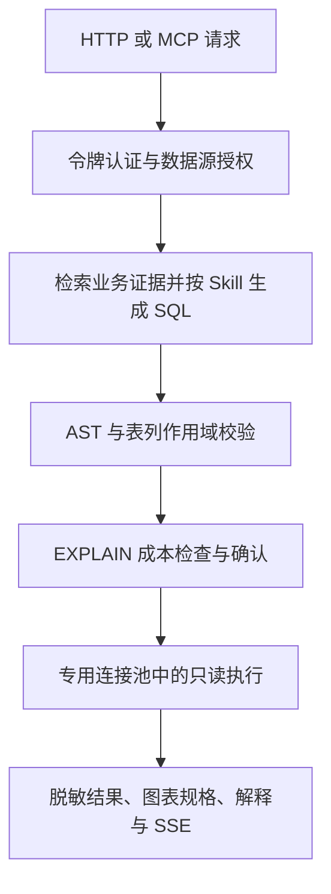

# DATA-AGENT：运行与阅读指南

产品品牌为 DATA-AGENT，底层复用 DB-GPT 框架。工作台及 MCP 显示名已统一，
自有环境变量使用 DATA_AGENT 前缀；框架包名、import、已安装的 dbgpt 命令和原配置文件名仍是技术依赖。
旧启动窗口需停止后重新运行 start.ps1，使新变量生效。

## 1. 这次改动解决什么问题

原来的 ReAct 入口混合了大量工具、文件和对话逻辑，不适合初学者追踪完整安全边界。
新增模块把一条分析请求明确拆成身份、检索、生成、校验、确认、执行、结果处理七个阶段。
它复用 DB-GPT 的模型服务和知识解析器，通过 DB-GPT 的 FastAPI 服务提供接口。

访问首页 `/` 进入 DATA-AGENT。分析工作台通过 `/api/v1/safe-analysis/query` 执行受控查询。
侧栏的数据源与知识库共享当前选中的数据源和访问令牌，返回对话时保留已有分析结果。

## 2. 先建立整体印象



调用方直接提供 SQL 时跳过模型生成，但不能跳过权限与执行检查。
遇到高风险计划时本次请求结束，返回确认编号，不持有数据库连接等待用户。
用户再次提交原 SQL 与确认编号后，重新解析、重新检查计划，消费绑定的一次性确认，然后执行。

## 3. 文件位置与阅读顺序

业务代码根目录：`packages/dbgpt-serve/src/dbgpt_serve/safe_analysis/`。

| 顺序 | 文件 / 函数 | 带着哪个问题看 |
| --- | --- | --- |
| 1 | `contracts.py` / `SourcePolicy` | 一个数据源拥有哪些访问限制？ |
| 2 | `service.py` / `AnalysisService.analyze()` | 一次请求按什么顺序走？哪一步可能提前返回？ |
| 3 | `config.py` / `authenticate()`、`authorize()` | 用户身份从哪里来？能查询哪个数据源？ |
| 4 | `retrieval.py` / `retrieve()` | 哪些 Schema 和指标可以进入模型？两种排名如何融合？ |
| 5 | `skills/` 与 `model.py` | 分析步骤如何特化？模型返回什么结构？ |
| 6 | `guard.py` / `validate_sql()` | 为什么 CTE 名称不能直接当作物理表？敏感列在 WHERE 里怎么拦？ |
| 7 | `executor.py` / `assess()`、`query()` | 为什么通过 AST 后还需要只读数据库连接？ |
| 8 | `audit.py` / `issue()`、`consume()` | 确认编号为什么不能换 SQL 使用？ |
| 9 | `results.py` / `sanitize()` | 页面、模型和图表拿到的是哪份结果？ |
| 10 | HTTP 的 `safe_analysis_api.py` | URL 怎么拼？事件如何序列化成 SSE？ |

HTTP 文件完整位置：
`packages/dbgpt-app/src/dbgpt_app/openapi/api_v1/safe_analysis_api.py`。

路由拼接：`dbgpt_server.py` 的 `/api` + router 的 `/v1/safe-analysis` + `/query`。

## 4. 从网页开始使用

下面命令在 **Windows PowerShell、仓库根目录 E:\DB-GPT** 执行。

### 4.1 依赖与演示数据

已有 DB-GPT 环境的情况下，新增核心依赖为 SQLGlot、rank-bm25 和 Qdrant 客户端。
它们已经写入 `packages/dbgpt-serve/pyproject.toml`。
若当前环境尚未同步，可以先安装新增模块依赖：

```powershell
uv pip install --python .venv/Scripts/python.exe "sqlglot>=28,<31" "rank-bm25>=0.2,<0.3" "qdrant-client>=1.17.1,<2"
.venv/Scripts/python.exe examples/safe_analysis/setup_demo.py
```

脚本创建 `data/safe-analysis-demo.sqlite3`，包含 10,000 行合成记录和 `sales_public` 安全视图。
重复执行不会清空已有数据。原始联系方式在 `sales_raw` 中，白名单只开放安全视图。

### 4.2 一条命令启动

当前环境已安装上述依赖，直接在仓库根目录运行：

```powershell
.\examples\safe_analysis\start.ps1
```

脚本幂等初始化演示数据、设置当前会话需要的环境变量、生成工作台令牌，
然后调用已安装的 `.venv/Scripts/dbgpt.exe` 启动服务，不需要构建 Node 前端。
如 PowerShell 因脚本执行策略阻止运行，可只为这一次进程运行：

```powershell
powershell -ExecutionPolicy Bypass -File .\examples\safe_analysis\start.ps1
```

等待服务启动后打开 **http://127.0.0.1:5670/**，
粘贴终端输出的工作台令牌，点击“连接工作台”。它不是模型 API key。
模型和 Embedding 的供应商地址、key 仍在 `configs/dbgpt-proxy-openai.toml` 中配置。
更换 TOML 可传 `-Config "configs/你的配置.toml"`；端口以该 TOML 为准。
已经有旧服务占用 5670 时，先在那个启动窗口按 Ctrl+C，再启动本脚本。

页面使用顺序：

1. 左侧选择 `sales_demo`，查看授权字段与指标口径。
2. 点击“查看一条示例记录”，无需模型即可检查数据库到页面的链路。
3. 点击“检查知识检索”，实际调用 Qdrant、Embedding、BM25 与 RRF，并在“检索依据”显示证据。
4. 输入自然语言问题并开始分析；若要求执行确认，核对 SQL 和原因，再点击“确认并执行”。
5. 在“分析结果 / 查询 SQL / 检索依据”切换查看。结果可导出脱敏 CSV；模型解释按 Markdown 渲染。

“停止”会请求取消并停止接收流；MySQL 的实际终止仍受后文所述限制。
令牌仅保存在当前标签页的 sessionStorage；点击“断开连接”清除它。
这个工作台暂未提供上传文件、编辑数据源或聊天历史功能；数据源与文档由管理员配置。

### 4.3 手工启动方式（可选）

```powershell
$env:DATA_AGENT_CONFIG = "E:/DB-GPT/configs/safe-analysis.example.json"
$env:DATA_AGENT_SALES_URL = "sqlite:///E:/DB-GPT/data/safe-analysis-demo.sqlite3"
$env:DATA_AGENT_TOKEN = [guid]::NewGuid().ToString("N") + [guid]::NewGuid().ToString("N")
```

这些变量属于当前 PowerShell 会话，随后从同一窗口启动服务。
安全分析令牌与模型供应商的 API key 是两种凭据；前者用于访问接口，后者仍由 DB-GPT 原模型配置管理。

保持你原来可用的 DB-GPT 启动命令。例如：

```powershell
uv run --no-sync dbgpt start webserver --config configs/dbgpt-proxy-openai.toml
```

`--no-sync` 用于已经安装完成的本地环境；首次安装仍需按 DB-GPT 的安装步骤同步。
本次 `uv lock` 因访问 PyPI 超时未能完成，`uv.lock` 未更新；依赖声明已经写入 pyproject，
当前环境已安装新增核心依赖。联网恢复后运行 `uv lock` 再进行正常同步。
示例默认服务地址为 `http://127.0.0.1:5670`，以你的实际端口为准。

### 4.4 命令行调用 API（仅调试需要）

正常使用直接操作网页即可。以下示例用于接口调试，不是必经操作。

另一个 PowerShell 需要使用启动窗口中生成的同一个令牌；可以在启动前记下它，勿提交到仓库。
以下命令也可以放在启动服务之前的同一窗口准备好。

```powershell
$headers = @{ Authorization = "Bearer $env:DATA_AGENT_TOKEN" }
$body = @{
    source = "sales_demo"
    sql = "SELECT id, region, amount FROM sales_public WHERE id = 1"
    explain = $false
    stream = $false
} | ConvertTo-Json
Invoke-RestMethod -Method Post -Uri "http://127.0.0.1:5670/api/v1/safe-analysis/query" -Headers $headers -ContentType "application/json; charset=utf-8" -Body ([System.Text.Encoding]::UTF8.GetBytes($body))
```

`explain=false` 表示不调用模型解释；仍会做 AST、成本和只读执行检查。
`stream=false` 返回完整事件数组，便于初学时查看。

### 4.5 模型名称与自然语言请求（接口示例）

在 `configs/safe-analysis.example.json` 把 `model` 改为 DB-GPT 已经注册的模型名称。
不在这个 JSON 里复制供应商 key，也不修改你已有的模型凭据。

请求中去掉 `sql`，改为：

```json
{
  "source": "sales_demo",
  "question": "按区域统计 2026 年 1 月的有效销售额",
  "skill": "comparison",
  "explain": true,
  "stream": false
}
```

如果返回 `confirmation_required`，先看 SQL 与风险原因，再将返回的 `sql` 和 `approval_id`
提交到同一个 `/query` 接口。确认有效期为 300 秒，绑定用户、数据源、规范化 SQL 与策略版本，只能用一次。
这是执行前的资源风险确认，不等于已经证明模型正确理解业务。

## 5. PostgreSQL / MySQL 怎么接

在配置的 `sources` 增加数据源，并在相应 principal 的 `sources` 列表授权。
`tables` 写实际允许查询的视图/表与字段类型，不能配置成全部表通配。

PostgreSQL 示例：

```json
{
  "url_env": "DATA_AGENT_PG_URL",
  "dialect": "postgres",
  "schema": "analytics",
  "tables": {"sales_public": {"id": "INTEGER", "amount": "NUMERIC"}},
  "metrics": ["销售额 = SUM(amount)"],
  "timeout_ms": 5000,
  "max_rows": 200,
  "confirm_scans": true
}
```

连接 URL 格式：`postgresql+psycopg://readonly_user:密码@host:5432/database`。
MySQL 使用 `mysql+pymysql://readonly_user:密码@host:3306/analytics`，`dialect` 写 `mysql`，
`schema` 写实际数据库名 `analytics`。密码中的保留字符需要 URL 编码。

可选依赖定义在 `dbgpt-serve` 的 `safe_analysis_databases` extra；
已有环境可以安装 `psycopg[binary]>=3.2,<4` 和 `pymysql>=1.1,<2`。

数据库账号必须由管理员预先只授予目标视图的 SELECT 权限，禁止复用管理员账号。
代码不会替管理员创建账号、授予权限或修改生产库。
PostgreSQL 执行时设置 READ ONLY、statement_timeout、lock_timeout 与受限 search_path；
MySQL 使用只读事务、MAX_EXECUTION_TIME 和 lock_wait_timeout，目标为 MySQL 8。

只读查询仍可能获取 PostgreSQL 的 ACCESS SHARE 等锁；“只读”不代表完全没有锁或资源消耗。
隔离连接池限制连接占用，不等于独立容器、数据库副本或操作系统级资源隔离。

## 6. CSV / Excel 怎么进入分析

表格先由管理员导入到持久化 DuckDB。运行时用只读连接查询已物化的表，模型无权提供文件路径。

```powershell
.venv/Scripts/python.exe -m dbgpt_serve.safe_analysis.import_table "E:/data/sales.csv" "E:/DB-GPT/data/sales.duckdb" sales
```

XLSX 同样支持，可通过 `--sheet "Sheet1"` 指定工作表。导入同名表会报错，不覆盖数据。
脚本输出字段类型、行数和连接 URL，将这些字段加入数据源白名单。

DuckDB 配置写 `dialect=duckdb`、`schema=main`，URL 通过环境变量配置为
`duckdb:///E:/DB-GPT/data/sales.duckdb`。运行时禁用外部文件访问，限制线程与内存；
不向模型开放 `read_csv`、`read_parquet`、`ATTACH` 或扩展安装。
数据库正在提供查询时，不要同时覆盖导入文件；新增版本后重启服务切换。

## 7. 文档、向量库和检索

`knowledge_files` 是相对于安全分析 JSON 文件的受信任文件路径。
支持 PDF、DOCX、Markdown、TXT，复用 DB-GPT 已有解析器；扫描 PDF 的识别能力取决于原解析器，
这里不新增 OCR。旧版二进制 `.doc` 没有在新入口开放。

文档文本按 1500 字符窗口、200 字符重叠切片。每个源建立自己的检索语料：
授权 Schema + 配置中的指标 + 已批准的口径文档。
口径文档也必须是可向该源用户公开的内容，不能把敏感文档放进去后期待 SQL 权限自动保护它。

当前示例默认 `vector=true`，并设置 `qdrant_path=../data/safe-analysis-qdrant`：
使用 Qdrant Python 客户端的**本地持久化模式**，不需要 Docker，也不需要监听 6333 端口。
各策略索引保存在独立子目录中；首次检索建立索引，需要 DB-GPT 的 Embedding 模型可用。
关闭后数据保留，重启后重新加载当前语料并写入相同 ID。当前配置适用于单个 Web 服务进程，
不要让多个进程同时打开同一索引目录。

Qdrant 排名与 BM25 排名通过 RRF 融合，使用 `sum(1 / (60 + rank))`，不直接混合原始分数。
将源的 `vector` 改为 `false` 可只用 BM25；它是明确的配置选项，不会在向量失败时静默降级。
配置或文档内容变化会改变索引名称，旧策略索引不会进入当前检索；旧集合需由管理员定期清理。

**Qdrant 的管理界面和分析工作台不是同一个页面。**
本地客户端模式没有 Qdrant HTTP 服务，因此没有 `http://localhost:6333/dashboard`。
若需要检查集合、向量与 payload 的 Qdrant Dashboard，应单独运行 Qdrant 服务端，
移除安全分析 JSON 的 `qdrant_path`，让它回到 DB-GPT StorageManager，
并在实际使用的 TOML 中配置服务端地址：

```toml
[rag.storage.vector]
type = "qdrant"
host = "127.0.0.1"
port = 6333
```

服务端默认 Dashboard 地址为 `http://localhost:6333/dashboard`，需先确保服务端确实运行。
服务端与本地路径不是同一个存储，切换后会建立新的索引。
本次没有启动 Docker 服务端，也没有修改你现有 TOML 的 Chroma 配置；
新安全入口使用 JSON 的本地 Qdrant，原功能仍由各自的配置控制。
两种模式都需要同一 TOML 中可用的 `models.embeddings`。
向量库返回结果只参与相关性排序；最终执行权限始终由 `guard.py` 决定。
Schema 当前由明确白名单配置维护，没有自动把数据库全量表反射并开放。

## 8. Skill 和 MCP 如何扩展

三个 Skill 是真实的 Markdown 文件，位于模块的 `skills/general`、`skills/trend`、`skills/comparison`。
它们分别特化通用分析、趋势分析和维度比较。`skills.py` 只允许加载登记名称，
不允许模型指定任意路径、执行脚本或用 Skill 覆盖权限。

MCP 使用 FastMCP 的 stdio 传输，提供两个工具：

- `retrieve_context(source, question)`：检索已授权的业务证据。
- `query_readonly(source, sql)`：通过同一 SQL 校验和执行流程查询。

MCP 进程转发到正在运行的 DB-GPT 安全 API，不再维护另一套执行逻辑。
配置 `DATA_AGENT_BASE_URL`（默认 `http://127.0.0.1:5670`）及访问令牌，然后运行：

```powershell
.venv/Scripts/python.exe -m dbgpt_serve.safe_analysis.mcp_server
```

为 MCP 客户端配置 command、args 和上述环境变量即可。
没有向模型暴露“自动确认”工具；遇到风险请求，由调用方通过 HTTP 展示并提交用户确认。
这里采用本地部署的访问令牌，不是多租户 OAuth 登录系统。

## 9. 已验证什么，尚未验证什么

本次测试使用临时合成数据，不访问真实业务库或付费模型。
本地测试结果为 **49 passed**，新增 Python 文件通过 Ruff 检查。
覆盖 AST 与作用域、敏感列、只读兜底、行数上限、超时、一次性确认、HTTP/SSE、
DuckDB CSV/XLSX 导入、Markdown 解析、向量适配契约与 MCP 工具边界，
以及真实 Qdrant 本地写入、查询、重新打开后的持久化与混合检索、工作台路由和资源白名单。
Qdrant 测试使用固定的测试 Embedding，没有调用你的模型供应商。
前端 SSE 分块与 CRLF 解析通过 Node 检查；HTTP 页面可达不等于已经完成视觉验收。
DATA-AGENT 改版后已在浏览器走通连接、示例查询、知识检索、高成本确认、表格、图表和 Markdown 解释。
预览使用固定测试模型和合成数据，不能作为真实供应商 API 已联调的证据。

```powershell
.venv/Scripts/python.exe -m pytest packages/dbgpt-serve/src/dbgpt_serve/safe_analysis/tests -q --basetemp .tmp-safe-analysis/pytest
```

PostgreSQL/MySQL 已实现方言与执行适配，但真实服务器上的权限、计划与取消行为需要部署环境联调。
Qdrant 服务端、真实 Embedding、供应商模型和外部 MCP 客户端也需要使用你的配置联调；
本地适配测试通过不代表已经测得模型正确率或线上性能。

取消：SQLite/DuckDB 使用 interrupt，PostgreSQL 使用驱动 cancel；MySQL 当前依靠服务端超时收敛，
不保证立即取消。API 的 `cancel_requested` 只代表收到取消请求。
请求状态保存在当前服务进程中，多进程部署需粘性路由或共享任务注册中心。
确认与审计使用 SQLite，同一主机可共享文件；跨主机部署应迁移到持久化服务数据库。
策略在启动后固定，修改权限后需要重启所有服务进程；重启后旧策略确认不可复用。

## 10. 实现取舍

- 只允许 SELECT/UNION、受限常用函数；不支持的 SQL 直接拒绝，避免猜测性放行。
- `SELECT *` 先按授权字段展开，敏感列不能通过别名、WHERE 或子查询绕过。
- 原始敏感列不开放；有分析价值的脱敏数据由数据库视图提供，结果标签脱敏只是补充。
- EXPLAIN 不加 ANALYZE；估计成本不是实际耗时，也不是完整的慢查询预测器。
- 审计只存请求编号、身份、源、SQL 摘要哈希、阶段、行数和耗时，不记录原始结果或 SQL 字面量。
- 图表输出声明式规格和安全数据，不运行模型生成的 JavaScript。
- SSE 返回执行阶段；模型解释失败时保留已完成的表格结果并返回 warning 与 done。

工作台源码位于 `packages/dbgpt-app/src/dbgpt_app/safe_analysis_web/`，
`assets/api.js` 负责 HTTP、`stream.js` 组装 SSE 事件、`app.js` 调度页面状态、
`render.js` 展示安全结果与图表。它与 DB-GPT 使用同一服务，不需要额外启动前端开发服务。
没有只替换旧聊天页面的 URL，因为两条链路的请求与事件格式不同。
